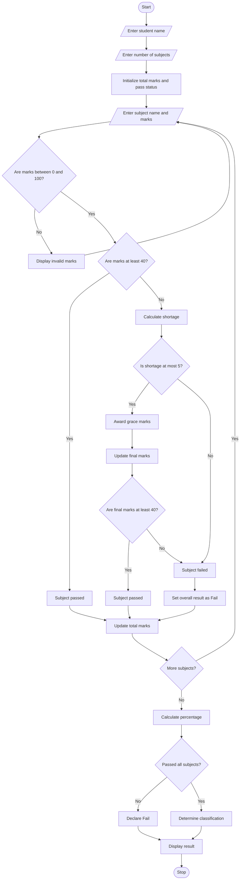

 Experiment 11: Examination Result and Grace-Mark Validation

 1. Problem Statement

Develop a Python program to process examination marks of a student across multiple subjects and determine the final result.

The program should:

- Accept marks obtained in multiple subjects.
- Check subject-wise minimum pass marks.
- Apply grace marks to students who narrowly fail a subject.
- Ensure that grace marks do not exceed the maximum subject marks.
- Calculate total marks and percentage.
- Generate the final result and classification.

Assumptions:

1. Maximum marks for each subject = 100.
2. Minimum pass marks = 40.
3. Maximum grace marks allowed per subject = 5.
4. Grace marks are awarded only when a student is short of the pass mark by 5 marks or less.
5. Classification:
   - 75% and above – Distinction
   - 60% to below 75% – First Class
   - 50% to below 60% – Second Class
   - 40% to below 50% – Pass
   - Below 40% – Fail

 2. Algorithm

1. Start the program.
2. Read the student's name.
3. Read the number of subjects.
4. Initialize total marks and grace marks.
5. For each subject:
   - Read the subject name.
   - Read the marks obtained.
   - Validate that marks are between 0 and 100.
   - Check whether the student has passed.
   - If marks are below 40, calculate the shortage.
   - If the shortage is 5 or less, award grace marks equal to the shortage.
   - Update the subject marks without exceeding 100.
   - Check the final pass status.
6. Calculate total marks and percentage.
7. If the student passes all subjects, determine the classification.
8. Otherwise, declare the student as failed.
9. Display subject-wise marks, grace marks, total marks, percentage, and final result.
10. Stop the program.

 3. Flowchart (Mermaid)

 5. Sample Input

EXAMINATION RESULT AND GRACE-MARK VALIDATION

Enter student name: Ravi
Enter number of subjects: 5

Subject 1
Enter subject name: English
Enter marks obtained: 85

Subject 2
Enter subject name: Mathematics
Enter marks obtained: 38

Subject 3
Enter subject name: Physics
Enter marks obtained: 72

Subject 4
Enter subject name: Chemistry
Enter marks obtained: 65

Subject 5
Enter subject name: Computer
Enter marks obtained: 90

 6. Sample Output

EXAMINATION RESULT AND GRACE-MARK VALIDATION

========== EXAMINATION RESULT ==========

Student Name: Ravi

Subject-wise Marks:

English : 85.0 | Grace Marks: 0
Mathematics : 40.0 | Grace Marks: 2.0
Physics : 72.0 | Grace Marks: 0
Chemistry : 65.0 | Grace Marks: 0
Computer : 90.0 | Grace Marks: 0

----------------------------------------

Total Marks: 352.0
Maximum Marks: 500
Total Grace Marks: 2.0
Percentage: 70.4 %
Final Result: PASS
Classification: First Class

========================================

