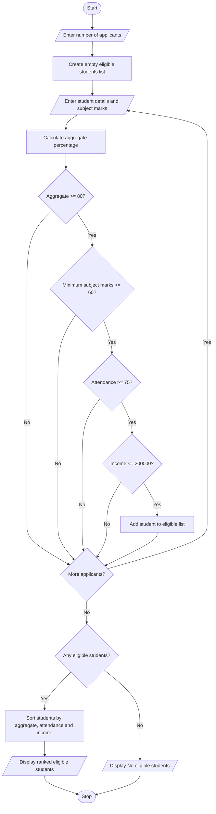

 Experiment 1: University Scholarship Allocation

1. Problem Statement

Design a Python program to evaluate students applying for a university scholarship based on the following criteria:

- Aggregate marks must be **80% or above**.
- Minimum marks in every subject must be **60 or above**.
- Attendance must be **75% or above**.
- Annual family income must be **₹2,00,000 or below**.

The program should identify eligible students and rank them according to the following rules:

1. Higher aggregate marks get higher priority.
2. If aggregate marks are equal, higher attendance gets higher priority.
3. If both aggregate marks and attendance are equal, lower family income gets higher priority.

 2. Algorithm

1. Start the program.
2. Read the number of applicants.
3. Create an empty list to store eligible students.
4. For each applicant:
   - Read the student's name.
   - Read the number of subjects.
   - Read marks in each subject.
   - Calculate aggregate percentage.
   - Read attendance percentage.
   - Read annual family income.
5. Check the eligibility conditions:
   - Aggregate marks >= 80.
   - Minimum subject marks >= 60.
   - Attendance >= 75.
   - Family income <= 200000.
6. If all conditions are satisfied, add the student details to the eligible students list.
7. Repeat until all applicants are evaluated.
8. Sort eligible students based on aggregate marks, attendance, and family income.
9. Display the ranked list of eligible students.
10. Stop.

 3. Flowchart (Mermaid)

 
 5. Sample Input

Enter number of applicants: 4

Enter details of student 1
Enter student name: Ravi
Enter number of subjects: 3
Enter marks in subject 1: 85
Enter marks in subject 2: 90
Enter marks in subject 3: 80
Enter attendance percentage: 90
Enter annual family income: 150000

Enter details of student 2
Enter student name: Priya
Enter number of subjects: 3
Enter marks in subject 1: 95
Enter marks in subject 2: 90
Enter marks in subject 3: 95
Enter attendance percentage: 95
Enter annual family income: 180000

Enter details of student 3
Enter student name: Arun
Enter number of subjects: 3
Enter marks in subject 1: 85
Enter marks in subject 2: 90
Enter marks in subject 3: 80
Enter attendance percentage: 90
Enter annual family income: 100000

Enter details of student 4
Enter student name: Kiran
Enter number of subjects: 3
Enter marks in subject 1: 70
Enter marks in subject 2: 75
Enter marks in subject 3: 80
Enter attendance percentage: 85
Enter annual family income: 150000

6. Sample Output

Eligible Students Ranked by Scholarship Priority

Rank: 1
Name: Priya
Aggregate: 93.33 %
Attendance: 95.0 %
Family Income: Rs. 180000.0

Rank: 2
Name: Arun
Aggregate: 85.0 %
Attendance: 90.0 %
Family Income: Rs. 100000.0

Rank: 3
Name: Ravi
Aggregate: 85.0 %
Attendance: 90.0 %
Family Income: Rs. 150000.0

