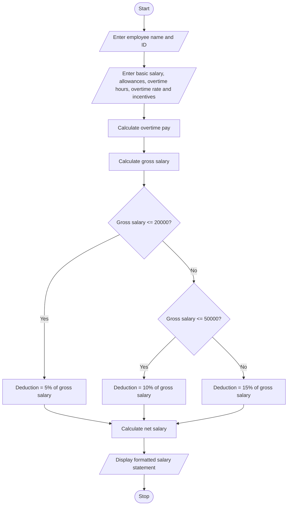

 Experiment 4: Employee Payroll and Deduction Analysis

1. Problem Statement

Develop a Python program to calculate an employee's salary based on basic pay, allowances, overtime, and incentives.

The program should:

- Calculate the gross salary by adding basic pay, allowances, overtime pay, and incentives.
- Apply deductions based on the gross salary using the following progressive salary slabs:
  - Gross salary up to ₹20,000: 5% deduction.
  - Gross salary from ₹20,001 to ₹50,000: 10% deduction.
  - Gross salary above ₹50,000: 15% deduction.
- Calculate the net salary after deductions.
- Generate a formatted salary statement displaying all salary details.

2. Algorithm

1. Start the program.
2. Read the employee's name and ID.
3. Read the basic salary.
4. Read allowances, overtime hours, overtime rate, and incentives.
5. Calculate overtime pay:
   - Overtime pay = Overtime hours × Overtime rate.
6. Calculate gross salary:
   - Gross salary = Basic salary + Allowances + Overtime pay + Incentives.
7. Calculate deductions:
   - If gross salary <= ₹20,000, deduction = 5% of gross salary.
   - If gross salary <= ₹50,000, deduction = 10% of gross salary.
   - Otherwise, deduction = 15% of gross salary.
8. Calculate net salary:
   - Net salary = Gross salary − Deduction.
9. Display the formatted salary statement.
10. Stop the program.

3. Flowchart (Mermaid)

 5. Sample Input

EMPLOYEE PAYROLL SYSTEM
Enter employee name: Rahul
Enter employee ID: E101
Enter basic salary: 30000
Enter allowances: 5000
Enter overtime hours: 10
Enter overtime rate per hour: 200
Enter incentives: 3000

 6. Sample Output

========== SALARY STATEMENT ==========
Employee Name       : Rahul
Employee ID         : E101
--------------------------------------
Basic Salary        : Rs. 30000.0
Allowances          : Rs. 5000.0
Overtime Pay        : Rs. 2000.0
Incentives          : Rs. 3000.0
--------------------------------------
Gross Salary        : Rs. 40000.0
Deduction           : Rs. 4000.0
--------------------------------------
Net Salary          : Rs. 36000.0
======================================

