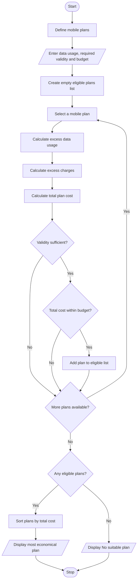

 Experiment 5: Multi-Plan Telecommunications Cost Optimization

1. Problem Statement

Develop a Python program to compare different mobile recharge plans based on data usage, validity period, and budget.

The program should:

- Display available mobile plans with their prices, data limits, and validity.
- Accept the user's data usage, required validity, and budget.
- Calculate additional charges if data usage exceeds the plan's data limit.
- Check whether each plan satisfies the user's budget and validity requirements.
- Identify and display the most economical eligible plan.

Assumed mobile plans:

| Plan | Price | Data Limit | Validity |
|---|---:|---:|---:|
| Basic | ₹199 | 100 GB | 28 days |
| Standard | ₹299 | 200 GB | 28 days |
| Premium | ₹399 | 300 GB | 56 days |

Excess data charge: ₹10 per GB.

 2. Algorithm

1. Start the program.
2. Define the available mobile plans.
3. Read the user's data usage.
4. Read the required validity period.
5. Read the user's budget.
6. Create an empty list to store eligible plans.
7. For each mobile plan:
   - Calculate excess data usage.
   - Calculate excess charges.
   - Calculate the total plan cost.
   - Check whether the plan satisfies the required validity and budget.
8. If the plan is eligible, add it to the eligible plans list.
9. If eligible plans are available:
   - Sort them according to total cost.
   - Display the most economical plan.
10. Otherwise, display a message that no suitable plan is available.
11. Stop the program.

 3. Flowchart (Mermaid)

 5. Sample Input

MOBILE PLAN COST OPTIMIZATION

Enter your data usage in GB: 150
Enter required validity in days: 28
Enter your budget: 350

 6. Sample Output

===== MOST ECONOMICAL MOBILE PLAN =====
Plan Name       : Standard
Total Cost      : Rs. 299
Data Limit      : 200 GB
Validity        : 28 days
Excess Data     : 0 GB

===== OTHER ELIGIBLE PLANS =====
Standard - Rs. 299

