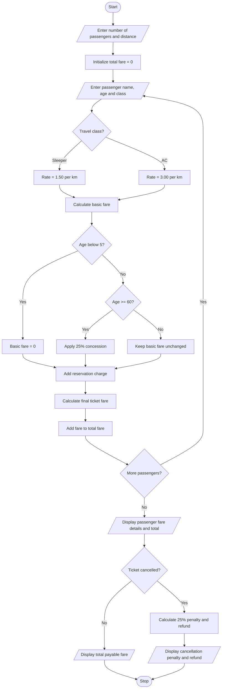

Experiment 6: Railway Fare and Reservation Calculator

1. Problem Statement

Develop a Python program to calculate railway fares for multiple passengers based on distance travelled, travel class, age-based concessions, reservation charges, and cancellation penalties.

The program should:

- Accept the number of passengers.
- Calculate the basic fare based on distance and travel class.
- Apply age-based concessions.
- Add reservation charges.
- Calculate the total fare for all passengers.
- Calculate the cancellation penalty and refund amount if a ticket is cancelled.
- Display a formatted ticket and fare statement.

Assumptions used in this program:

| Travel Class | Fare per km |
|---|---:|
| Sleeper | ₹1.50 |
| AC | ₹3.00 |

Additional rules:

- Children below 5 years: No basic fare.
- Senior citizens aged 60 and above: 25% concession.
- Reservation charge: ₹50 per passenger.
- Cancellation penalty: 25% of the final ticket fare.

 2. Algorithm

1. Start the program.
2. Read the number of passengers.
3. Read the journey distance.
4. Initialize the total fare to zero.
5. For each passenger:
   - Read the passenger's name and age.
   - Read the travel class.
   - Calculate the basic fare based on distance and class.
   - If age is below 5, set the basic fare to zero.
   - If age is 60 or above, apply a 25% concession.
   - Add the reservation charge.
   - Calculate the final ticket fare.
   - Add the ticket fare to the total fare.
6. Display the fare details for each passenger.
7. Ask whether the ticket is cancelled.
8. If cancelled:
   - Calculate the cancellation penalty.
   - Calculate the refund amount.
9. Otherwise, display the total payable fare.
10. Stop the program.

 3. Flowchart (Mermaid)

 5. Sample Input

RAILWAY FARE AND RESERVATION SYSTEM

Enter number of passengers: 3
Enter journey distance in km: 500

Passenger 1
Enter passenger name: Ravi
Enter passenger age: 30
Enter class (Sleeper/AC): Sleeper

Passenger 2
Enter passenger name: Priya
Enter passenger age: 65
Enter class (Sleeper/AC): AC

Passenger 3
Enter passenger name: Arun
Enter passenger age: 4
Enter class (Sleeper/AC): Sleeper

Is the ticket cancelled? (yes/no): yes

 6. Sample Output

Passenger Name: Ravi
Travel Class: sleeper
Basic Fare: Rs. 750.0
Reservation Charge: Rs. 50
Final Fare: Rs. 800.0

Passenger Name: Priya
Travel Class: ac
Basic Fare: Rs. 1125.0
Reservation Charge: Rs. 50
Final Fare: Rs. 1175.0

Passenger Name: Arun
Travel Class: sleeper
Basic Fare: Rs. 0
Reservation Charge: Rs. 50
Final Fare: Rs. 50

================================
TOTAL RAILWAY FARE: Rs. 2025.0
================================

CANCELLATION DETAILS
Total Fare: Rs. 2025.0
Cancellation Penalty: Rs. 506.25
Refund Amount: Rs. 1518.75

*Note: The fare rates, concessions, and cancellation penalty are assumed values for this programming exercise, not actual railway booking rules.*
