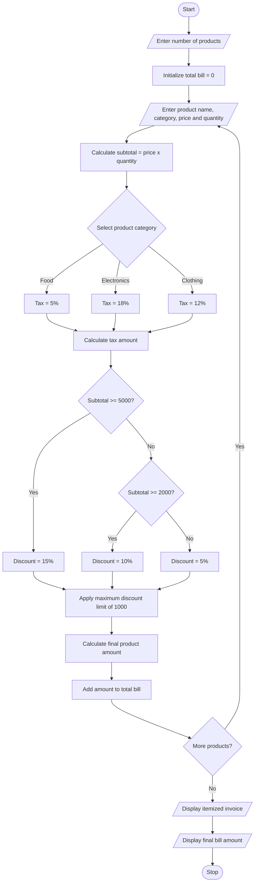

 Experiment 7: Retail Billing with Multiple Discount Rules

 1. Problem Statement

Develop a Python program to generate an itemized retail bill for multiple products by considering product quantities, category-specific taxes, discount rules, and maximum concession limits.

The program should:

- Accept multiple product names, categories, prices, and quantities.
- Calculate the total price of each product.
- Apply category-specific taxes.
- Apply discounts based on purchase amount.
- Limit the maximum discount allowed per product to ₹1,000.
- Calculate the final bill amount.
- Generate an itemized invoice displaying product details, taxes, discounts, and the total amount.

Assumptions used in this program:

 Category-wise Tax Rates

| Product Category | Tax Rate |
|---|---:|
| Food | 5% |
| Electronics | 18% |
| Clothing | 12% |

 Discount Rules

| Purchase Amount | Discount |
|---|---:|
| ₹5,000 and above | 15% |
| ₹2,000 to ₹4,999 | 10% |
| Below ₹2,000 | 5% |

Maximum discount per product = ₹1,000

 2. Algorithm

1. Start the program.
2. Read the number of products.
3. Initialize the total bill to zero.
4. For each product:
   - Read product name.
   - Read product category.
   - Read price and quantity.
   - Calculate subtotal = Price × Quantity.
5. Calculate tax based on the product category:
   - Food = 5%.
   - Electronics = 18%.
   - Clothing = 12%.
6. Calculate discount based on the subtotal:
   - If subtotal >= ₹5,000, apply 15%.
   - If subtotal >= ₹2,000, apply 10%.
   - Otherwise, apply 5%.
7. Check the maximum discount limit of ₹1,000 per product.
8. Calculate the final product amount:
   - Final amount = Subtotal + Tax − Discount.
9. Add the product amount to the total bill.
10. Repeat until all products are processed.
11. Display the itemized invoice.
12. Display the final bill amount.
13. Stop the program.

 3. Flowchart (Mermaid)

 5. Sample Input

===== RETAIL BILLING SYSTEM =====

Enter number of products: 3

Product 1
Enter product name: Rice
Enter category (Food/Electronics/Clothing): Food
Enter product price: 1000
Enter quantity: 2

Product 2
Enter product name: Laptop
Enter category (Food/Electronics/Clothing): Electronics
Enter product price: 50000
Enter quantity: 1

Product 3
Enter product name: Shirt
Enter category (Food/Electronics/Clothing): Clothing
Enter product price: 1000
Enter quantity: 2

 6. Sample Output

Product Name: Rice
Subtotal: Rs. 2000.0
Tax: Rs. 100.0
Discount: Rs. 200.0
Final Amount: Rs. 1900.0

Product Name: Laptop
Subtotal: Rs. 50000.0
Tax: Rs. 9000.0
Discount: Rs. 1000
Final Amount: Rs. 58000.0

Product Name: Shirt
Subtotal: Rs. 2000.0
Tax: Rs. 240.0
Discount: Rs. 200.0
Final Amount: Rs. 2040.0

========== FINAL INVOICE ==========
Total Bill Amount: Rs. 61940.0
===================================

