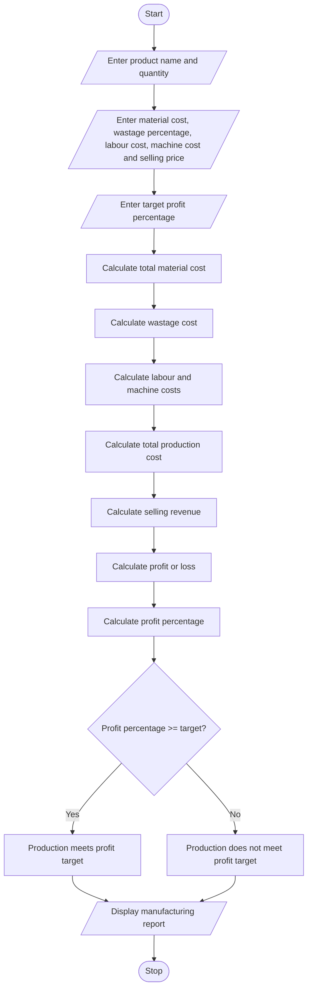

 Experiment 8: Manufacturing Cost and Profitability Analysis

 1. Problem Statement

Develop a Python program to calculate the total manufacturing cost and profitability of a product by considering material costs, labour charges, material wastage, machine costs, and selling prices.

The program should:

- Accept product details and the number of units manufactured.
- Calculate total material cost.
- Calculate material wastage cost.
- Calculate labour and machine costs.
- Calculate total production cost.
- Calculate total selling revenue.
- Determine profit or loss.
- Calculate profit percentage.
- Check whether production meets the specified profit target.

 2. Algorithm

1. Start the program.
2. Enter the product name and quantity.
3. Enter material cost per unit.
4. Enter wastage percentage.
5. Enter labour cost per unit.
6. Enter machine cost per unit.
7. Enter selling price per unit.
8. Enter the target profit percentage.
9. Calculate total material cost.
10. Calculate wastage cost.
11. Calculate total labour cost.
12. Calculate total machine cost.
13. Calculate total production cost.
14. Calculate total selling revenue.
15. Calculate profit or loss.
16. Calculate profit percentage.
17. Compare profit percentage with the target profit.
18. Display the manufacturing report.
19. Stop the program.

 3. Flowchart (Mermaid)

 5. Sample Input

MANUFACTURING COST AND PROFITABILITY ANALYSIS

Enter product name: Chairs
Enter number of units manufactured: 100
Enter material cost per unit: 200
Enter wastage percentage: 10
Enter labour cost per unit: 50
Enter machine cost per unit: 30
Enter selling price per unit: 400
Enter target profit percentage: 20

 6. Sample Output

========== MANUFACTURING REPORT ==========

Product Name: Chairs
Quantity: 100
Material Cost: Rs. 20000.0
Wastage Cost: Rs. 2000.0
Labour Cost: Rs. 5000.0
Machine Cost: Rs. 3000.0

------------------------------------------

Total Production Cost: Rs. 30000.0
Selling Revenue: Rs. 40000.0
Profit: Rs. 10000.0
Profit Percentage: 33.33 %
Target Profit: 20.0 %

Production meets the profit target.

==========================================

