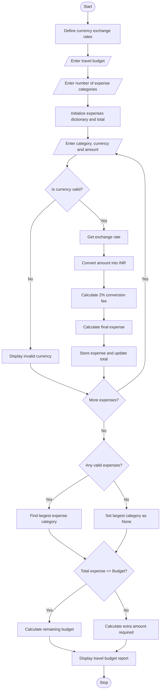

Experiment 9: Multi-Currency Travel Budget Analysis

 1. Problem Statement

Develop a Python program to calculate and analyze travel expenses in different currencies using supplied exchange rates.

The program should:

- Accept travel expenses in different currencies.
- Convert expenses into Indian Rupees (INR).
- Apply a currency conversion fee of 2%.
- Calculate the total travel expenditure.
- Compare total expenditure with the available budget.
- Identify the largest expense category.
- Display a formatted travel budget report.

Assumptions:

| Currency | Exchange Rate |
|---|---:|
| USD | ₹83 |
| EUR | ₹90 |
| GBP | ₹105 |

- Currency conversion fee = 2%.
- Travel budget = ₹30,000.

*Exchange rates are assumed values for this programming exercise.*

 2. Algorithm

1. Start the program.
2. Define exchange rates for USD, EUR, and GBP.
3. Read the travel budget in INR.
4. Read the number of expense categories.
5. Create an empty dictionary to store expenses.
6. For each expense category:
   - Read the expense category.
   - Read the currency type.
   - Read the expense amount.
   - Check whether the currency is valid.
   - Convert the amount into INR using the exchange rate.
   - Calculate the 2% conversion fee.
   - Add the conversion fee to the converted amount.
   - Store the final expense in the dictionary.
7. Calculate the total travel expenditure.
8. Identify the largest expense category.
9. Compare total expenditure with the travel budget.
10. Display the travel expense report.
11. Stop the program.
 3. Flowchart (Mermaid)

 5. Sample Input

MULTI-CURRENCY TRAVEL BUDGET ANALYSIS

Enter travel budget in INR: 30000
Enter number of expense categories: 3

Expense 1
Enter expense category: Food
Enter currency (USD/EUR/GBP): USD
Enter expense amount: 100

Expense 2
Enter expense category: Hotel
Enter currency (USD/EUR/GBP): EUR
Enter expense amount: 200

Expense 3
Enter expense category: Transport
Enter currency (USD/EUR/GBP): GBP
Enter expense amount: 50

 6. Sample Output

Converted Amount: Rs. 8300.0
Conversion Fee: Rs. 166.0
Final Expense: Rs. 8466.0

Converted Amount: Rs. 18000.0
Conversion Fee: Rs. 360.0
Final Expense: Rs. 18360.0

Converted Amount: Rs. 5250.0
Conversion Fee: Rs. 105.0
Final Expense: Rs. 5355.0

========== TRAVEL BUDGET REPORT ==========

Food : Rs. 8466.0
Hotel : Rs. 18360.0
Transport : Rs. 5355.0

------------------------------------------

Total Travel Expense: Rs. 32181.0
Available Budget: Rs. 30000.0
Budget Status: Budget Exceeded
Extra Amount Required: Rs. 2181.0

------------------------------------------

Largest Expense Category: Hotel
Largest Expense Amount: Rs. 18360.0

==========================================

