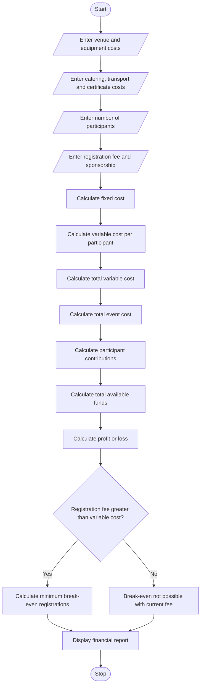

 Experiment 10: Campus Event Financial Planning

1. Problem Statement

Develop a Python program to calculate the financial requirements of a campus event.

The program should calculate venue, equipment, catering, transportation, and certificate costs. It should determine participant contributions, sponsorship shortfalls, profit or loss, and the minimum number of registrations required to break even.

Assumptions:

| Particulars | Amount |
|---|---:|
| Venue cost | ₹10,000 |
| Equipment cost | ₹5,000 |
| Catering per participant | ₹200 |
| Transport per participant | ₹50 |
| Certificate per participant | ₹50 |
| Registration fee per participant | ₹400 |
| Sponsorship | ₹5,000 |
| Number of participants | 100 |

 2. Algorithm

1. Start the program.
2. Read venue and equipment costs.
3. Read catering, transport, and certificate costs per participant.
4. Read the number of participants.
5. Read the registration fee and sponsorship amount.
6. Calculate fixed cost by adding venue and equipment costs.
7. Calculate variable cost per participant.
8. Calculate total variable cost.
9. Calculate total event expenditure.
10. Calculate participant contributions.
11. Calculate total available funds by adding participant contributions and sponsorship.
12. Calculate profit or loss.
13. Calculate the minimum registrations required to break even.
14. Display the financial report.
15. Stop the program.

 3. Flowchart (Mermaid)




 5. Sample Input

```text
Enter venue cost: 10000
Enter equipment cost: 5000
Enter catering cost per participant: 200
Enter transport cost per participant: 50
Enter certificate cost per participant: 50
Enter number of participants: 100
Enter registration fee per participant: 400
Enter sponsorship amount: 5000
```

## 6. Sample Output


CAMPUS EVENT FINANCIAL PLANNING

========== EVENT FINANCIAL REPORT ==========

Fixed Cost: Rs. 15000.0
Variable Cost Per Participant: Rs. 300.0
Total Variable Cost: Rs. 30000.0
Total Event Cost: Rs. 45000.0

Participant Contributions: Rs. 40000.0
Sponsorship Amount: Rs. 5000.0
Total Available Funds: Rs. 45000.0

Event is at Break-Even Point

Minimum Registrations Required: 100

============================================


profit or loss, and minimum registrations required to break even. For the given sample input, 100 registrations are required to reach the break-even point.
